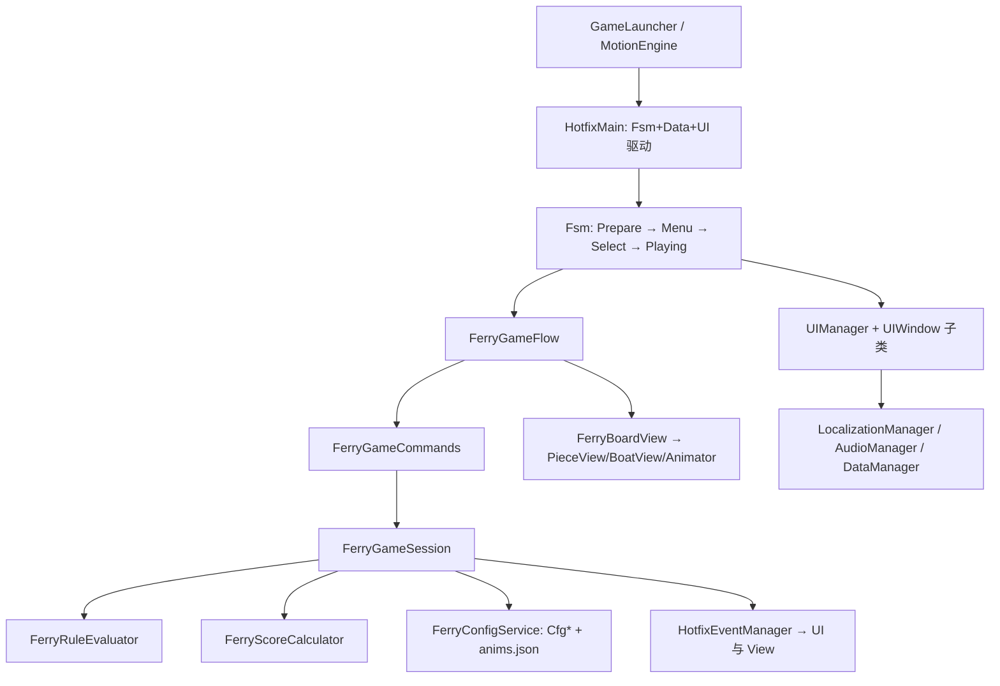

## 产品概述

把 `D:\Ferryman_setup` 的「摆渡解谜（Ferryman）」玩法迁入 `D:\Demo1` 框架工程：清空现有 Demo 战斗业务，仅保留框架，用本项目的 YooAsset 资源管理、UIWindow/UIManager、AssetConfig 配表、DataManager 存档、LocalizationManager 多语言、AudioManager 音频重写过河游戏业务，并先产出可长期遵循的代码规则与任务设计。

## 核心功能

- **棋盘**：多码头定长槽位（`dock[6][10]` 语义）+ 多棋子 + 1 艘船（`boatSpace` 容量，棋子各占 `boatSpace` 格）；对岸以 `boardX` 镜像 X 生成，无寻路、纯 X 轴线性插值移动。
- **操作三步**：上船 `Board` → 渡河 `Row(direction)` → 下船 `Unload`；船离岸瞬间结算被留下码头上的「互相吃」。
- **吃子规则**：数据表驱动（`eat / targetPiece / minCount / priority`），支持「数量劣势否决」这类否定规则；`essential=0` 的陪衬单位被吃不判负。
- **胜负**：`essential=1` 被吃 → 立即失败；所有存活单位抵达终点码头 → 胜利。
- **计分**：仅统计终点码头，每单位 `50 × 该码头同名数量`；同名 ≥2 显示 `NxCombo` 浮字；记录用时与最高分。
- **两种模式**：Classic 61 关；Combo/Survival 28 关（每 `respawnTime` 次渡河补 `spawnCount` 只、`waiting` 队列、凑够 `dismissCount` 可 `Dismiss` 遣散叠 Combo）。
- **界面**：主菜单、关卡选择（地图节点 + 卡片）、游戏内 HUD（码头名 / `boat 3/3` / 计时 / Rules / Hint / Help / Retry / 队列）、结算弹窗、规则说明、帮助、设置、教程气泡覆盖层。
- **表现**：独立 2D 场景 + 正交相机 + SpriteRenderer 呈现棋盘/棋子/船/船夫/水面与鱼群循环帧；大图按帧矩形切帧播放；浮字、教程箭头。
- **配套**：关卡进度与解锁、最高分/总分存档；UI 与配置文本多语言（简/繁/英）；音效与背景音乐；与框架一致的启动状态链与窗口层级。

## 交付边界

本次交付的是**规范 + 任务设计**：代码规则与编写规范、分层与目录设计、配表设计、框架改造清单、按里程碑拆分的开发任务与验收标准；不含业务代码实现。

## 技术栈

沿用现有工程，不引入新框架：Unity（Built-in 管线）+ UGUI + YooAsset（全路径寻址、EditorSimulate/Offline 双模式）+ MotionFramework（Audio/Scene/Pool/Event）+ 自研 Hotfix 层（`UIWindow`/`UIManager`/`AssetConfig`/`DataManager`/`HotfixFsm`/`HotfixEventManager`）。配表走 `Tool/ExcelTools`（已参数化：`-e 表格目录 -t cs|bytes -o 导出目录`）。2D 棋盘使用 `SpriteRenderer` + 正交相机。

## 实施方案

### 分层与依赖

HTML/框架不变，只在 Hotfix 内新增业务子树，依赖单向：`View → Core（逻辑）→ Data（配置/存档）`，`Core` 不引用 `UnityEngine.UI`，尽量不引用 `UnityEngine`（仅允许 `Vector2`/`Mathf` 这类纯数学）。

**关键约束**：不能为业务新增 asmdef——`UIManager` 通过 `typeof(HotfixTypeHelper).Assembly` 反射收集窗口，拆程序集会静默漏窗口。因此分层靠「目录约定 + 编辑器校验脚本」保障：新增 `Editor/Validation/FerryLayeringValidator.cs`，扫描 `Hotfix/Ferryman/Core/**` 中出现 `using UnityEngine`/`UnityEngine.UI` 即报错，作为编译期替代。

### 竞技/逻辑核心移植策略

以 `FerryMan_Unity` 的实现为业务契约（逆向文档 `docs/re/05-unity-porting.md` 作为数值校验），而不是照抄 20 个整数状态机：

- `FerryGameSession`：构造函数注入 `FerryConfigService`（替掉静态 `GameDatabase`），去掉 `Mathf/Xxx.Slots` 像素依赖，`DockInfo` 只保留 `dockIndex / slotCount`，`Vector2 Slots` 下沉到 `View` 层。
- `FerryRuleEvaluator`：从 `GameSession.PickVictim/IsSuppressed/Eat` 整段抽出（priority 两趟扫描 + 数量条件 + 否定规则），独立可测。
- `FerryScoreCalculator`：`50 × 终点码头同名数量`，常量进 `FerryDefine.ScorePerPiece`。
- 五条必须对齐的行为：50×同名计分、纯 X 插值（禁 A*）、对岸镜像、码头定长槽位、状态机不拆碎。
- Combo：`spawnCount / respawnTime / dismissCount / waiting` 在 `Level` 表；补员在 `Row` 成功后触发，`Dismiss` 结算叠倍率。

### 配置数据（Excel 导表）

7 张表进 `表格\`，5 行表头（类型 / 小驼峰字段名 / `C` 标记 / 策划描述 / 中文名），`id` 列必备，`List<int>` 用 `;` 分隔，文本列用 `language` 走 `LANG`：

| 表 | 作用 | 关键列 |
| --- | --- | --- |
| `Level` | 关卡主表 | id, kind(0经典/1生存), background, boat, boatSpace, waterType, canvasWidth, spawnCount, respawnTime, dismissCount, waiting(List<int>), tutorialKey |
| `Piece` | 棋子模板 | id, template, displayName(language), description(language), sheet, sound, speed, boatSpace, essential, moveable, canEat, renderOffsetX/Y, colorR/G/B |
| `PieceRule` | 吃子规则（从表） | id, pieceID, eat, targetPieceID, minCount, priority, desc |
| `LevelPiece` | 关卡布阵（从表） | id, levelID, pieceID, dockIndex, slotIndex, order |
| `LevelScene` | 场景物件（从表） | id, levelID, template, image, x, y, flip, order, renderOrder, animated, type |
| `LevelMap` | 地图节点（从表） | id, levelID, mode(0经典/1生存), x, y, order |
| `TutorialStep` | 教程气泡（从表） | id, levelID, step, text(language), width, x, y, ax1, ay1, ax2, ay2, center |


原 `LevelDto` 内嵌的 `pieces / scene / tutorialSteps` 必须拆从表，否则单表会有不定长嵌套，导表工具无法表达；`animas.frames`、`sceneAnims`、`hero`（帧矩形，体积大且非策划直接编辑）走 `GameRes/Ferryman/Data/anims.json` 由 YooAsset 以 `TextAsset` 加载。

**导表分叉处理（明确取舍）**：`Tool/ExcelTools` 产出的是 `ConfigTable + ReadTable(ByteBuffer)` 二进制版，工程内现有 Cfg 是 `ConfigTab + AddElement(...)` 手改版。本次统一采用后者：新建 `CfgLevel/CfgPiece/...` 手写容器（结构照 `CfgSkill.cs`），由导表导出 CSV/中间产物后人工或脚本填充 `AddElement`；不在本阶段迁移到二进制读表管线（改动面太大，会牵动 `AssetConfig` 与全部业务）。

### 表现层

- 新增 2D 场景 `Assets/GameRes/Scene/Ferryman.unity`：`Main Camera`（正交，`orthographicSize` 由设计稿 1000×562 与 `canvasWidth` 推导）+ 3 个排序容器 `Background / Board / Foreground`，场景内不挂业务脚本（沿用现有约定）。
- `FerryBoardView` 由状态机 `HotfixStatePlaying.Tick(deltaTime)` 驱动（不写自己的 `Update`），负责把逻辑事件翻译成插值移动/帧动画；`FerryBoardAnchor` 统一做「设计稿像素 → 世界单位」换算（1 设计像素 = `orthographicSize*2/Screen.height`）。
- 大图切帧：`FerrySpriteAnimator` 用 `Sprite.Create` 按帧矩形从 `Texture2D` 切帧并缓存 `Dictionary<sheet, Sprite[]>`；只加载当前关用到的 sheet，切关时 `handle.Release()`，避免 382 张常驻。
- 对象池：棋子/船的 GameObject 走 `GameObjectPoolManager.Spawn(location)`，池名即资源全路径。

### UI

严格沿用现有五步：`GameRes/UIPanel/<枚举名>.prefab`（根 `Canvas + GraphicRaycaster + UIManifest`）→ `EWindowType` 加成员 → `[Window(EWindowType.X, EWindowLayer.Y)]` 窗口类 → `UIManifest` 自动刷新 → 收集器已含目录。层级：Menu/Select/Result/Rules/Help/Options 用 `Panel`，Hud 用 `HUD`，教程气泡用 `Tips`，`UILoading` 保留。`UIWindow` 只读数据、发意图、订阅事件，全部交互走 `FerryGameCommands`。

### 架构关系



## 实施要点

- **删除雷区必须同批改**：`EWindowType`、`EHotfixStateType`、`HotfixMain.Start()` 的 `AddState`、`DataManager.Start()` 的显式注册、`HotfixEventMessageDefine`、`AssetBundleCollectorSetting.asset` 的 CollectPath、`Localization.csv` 路径；任一处漏改会编译失败或运行期 `KeyNotFoundException`。
- **性能**：单关 sheet 按需加载/释放；帧动画用共享 `Sprite[]` 缓存，避免每帧 `Sprite.Create`；棋子移动统一在 `FerryBoardView` 的一次遍历内推进，不做逐棋子协程。
- **日志**：`HotfixLogger`，禁止 `Debug.Log`；关卡加载/规则求值失败要给可定位的 key 与关卡 id。
- **兼容**：`MotionFramework`、`ThirdParty`、`Runtime/**`、`Tool/ExcelTools`、`Runtime/Localization` 一律不动，只做增量。

## 目录结构（相对 `d:/Demo1`）

```
Assets/GameScript/Hotfix/
├─ Ferryman/
│  ├─ Core/                                   # [NEW] 逻辑层，禁 UnityEngine.UI
│  │  ├─ Define/FerryDefine.cs                # 常量：ScorePerPiece=50、槽位上限、动画 fps 默认值、资源路径前缀
│  │  ├─ Define/EFerryGameState.cs            # Boot/Menu/Select/Playing/Result
│  │  ├─ Model/FerryPiece.cs                  # 运行时棋子：CfgPiece + dockIndex/slotIndex/eaten/dismissed/order
│  │  ├─ Model/FerryDock.cs                   # 码头：dockIndex、槽位占用、棋子列表（不含像素坐标）
│  │  ├─ Model/FerryBoat.cs                   # 船：所在码头、停靠侧、装载列表、容量
│  │  ├─ Model/FerryGameSession.cs            # 核心：Board/Unload/Row/TickSpawn/Dismiss/CheckWinState
│  │  ├─ Rule/FerryRuleEvaluator.cs           # PickVictim/IsSuppressed/Eat/HasAnyPrey
│  │  ├─ Rule/FerryScoreCalculator.cs         # 50×同名数、Combo 倍率
│  │  └─ Flow/{FerryGameFlow.cs, FerryGameCommands.cs}  # 状态机 + UI 唯一入口
│  ├─ View/
│  │  ├─ FerryBoardView.cs                    # 棋盘总控，Tick 驱动，事件→表现
│  │  ├─ FerryDockView.cs / FerryPieceView.cs / FerryBoatView.cs
│  │  ├─ FerrySpriteAnimator.cs               # 大图切帧播放（缓存 Sprite[]）
│  │  ├─ FerryFloatTextView.cs                # NxCombo 浮字
│  │  └─ FerryBoardAnchor.cs                  # 设计稿像素→世界坐标换算、相机适配
│  └─ Data/
│     ├─ FerryConfigService.cs                # 注入式配置查询：GetLevel/GetPieces/GetRules/GetScene
│     ├─ FerryAnimData.cs                     # anims.json 的 DTO + 载入
│     └─ FerryLevelLoader.cs                  # Cfg* + anims → FerryGameSession
├─ Data/Datas/DataFerryProfile.cs             # [NEW] 进度/解锁/最高分/总分，DataBase 派生
├─ Data/DataManager.cs                        # [MODIFY] 显式注册列表
├─ Fsm/States/HotfixStateMenu.cs              # [NEW]
├─ Fsm/States/HotfixStateSelect.cs            # [NEW]
├─ Fsm/States/HotfixStatePlaying.cs           # [NEW] 建场景/棋盘/HUD，Tick 驱动 BoardView
├─ Fsm/States/HotfixStateNotice.cs|Login.cs|Town.cs   # [DELETE]
├─ Fsm/EHotfixStateType.cs                    # [MODIFY] 成员替换
├─ HotfixMain.cs                              # [MODIFY] 状态注册与首状态
├─ UI/EWindowType.cs                          # [MODIFY] 删 UILogin/UIMain/UISetting，加 8 个界面
├─ UI/Windows/UIMenu.cs|UISelect.cs|UIHud.cs|UIResult.cs|UIRules.cs|UIHelp.cs|UIOptions.cs|UITutorial.cs  # [NEW]
├─ UI/Windows/UILogin.cs|UIMain.cs|UISetting.cs|_UIXXX.cs   # [DELETE]，UILoading.cs 保留
├─ Event/HotfixEventMessageDefine.cs          # [MODIFY] 删 LoginEvent/BattleEvent，加 FerryEvent
├─ Config/AutoGenerateConfig/CfgLevel.cs|CfgPiece.cs|CfgPieceRule.cs|CfgLevelPiece.cs|CfgLevelScene.cs|CfgLevelMap.cs|CfgTutorialStep.cs  # [NEW]
├─ Config/AutoGenerateConfig/CfgAvatar.cs|CfgMonster.cs|CfgPlayer.cs|CfgSkill.cs|CfgAnimation.cs  # [DELETE]
├─ Battle/**                                 # [DELETE] 整个 Demo 战斗层
└─ Config/LANG.cs                             # 保留

Assets/GameScript/Editor/Validation/FerryLayeringValidator.cs   # [NEW] 分层校验菜单
Assets/GameRes/Scene/Ferryman.unity              # [NEW] 2D 棋盘场景
Assets/GameRes/Ferryman/Entity/*.png             # [NEW] 棋子/船/背景（源自 Ferryman_Assets\Art\Resource）
Assets/GameRes/Ferryman/Data/anims.json          # [NEW] 帧矩形/场景动画/船夫动画
Assets/GameRes/Ferryman/Audio/*.wav              # [NEW] 18 个音效，音乐转 ogg
Assets/GameRes/UIPanel/UIMenu|UISelect|UIHud|UIResult|UIRules|UIHelp|UIOptions|UITutorial.prefab  # [NEW]
Assets/GameRes/UIAtlas/UIFerry.spriteatlas       # [NEW]
Assets/AssetBundleCollectorSetting.asset         # [MODIFY] 加 Ferryman/Entity、Ferryman/Data、Ferryman/Audio
Assets/GameRes/Config/Localization.csv           # [MODIFY] 追加 Ferry 文案 Key
Docs/Ferryman-CodingRules.md                     # [NEW] 规范落盘
表格/{Level,Piece,PieceRule,LevelPiece,LevelScene,LevelMap,TutorialStep}.xlsx  # [NEW]
```

## 关键接口

```
namespace Hotfix
{
	/// <summary>过河玩法核心：纯逻辑，不引用 UnityEngine.UI</summary>
	public class FerryGameSession
	{
		public int CurrentDock { get; }
		public int RemainingMoveableCount { get; }
		public bool CanBoard(int pieceId);
		public bool Board(int pieceId);
		public bool Unload();
		public bool Row(int direction);
		public FerryDismissResult Dismiss();
		public void TickSpawn();
		public EFerryResult CheckWinState();
		public List<FerryEatRecord> TakeEatRecords();
		public FerryScoreResult ScoreLevel(float elapsedSeconds);
	}
}
```

## 里程碑与验收

M0 清理并跑通空壳（Prepare→Menu 空窗口、无编译错）→ M1 配表与配置服务（7 张表可导出、`FerryConfigService` 能查到 90 关）→ M2 纯逻辑层（3 关可跑通胜负/计分，无 UI）→ M3 棋盘表现层（棋子/船/帧动画/浮字）→ M4 90 关数据接入 → M5 八个界面 → M6 Combo/教程 → M7 存档/多语言/音频 → M8 性能与打磨。

## 风险与取舍

1. 原版吃子规则求值逆向未定位（`docs/re/03-gameplay-core.md` §6.3 标 ❓），以 Unity 版 `PickVictim/IsSuppressed` 为业务契约，需用 3~5 关做回归比对。
2. 导表工具与工程内手改 Cfg 存在二进制/硬编码分叉，本阶段选择手改硬编码并记录债务。
3. 大图切帧内存与 DrawCall：按关卡粒度加载 sheet，必要时合并图集。
4. `.wma` 音乐 Unity 不支持，需转 ogg；原版排版指令 `\s\v\h` 不迁移。
5. 教程气泡依赖 1000×562 设计稿坐标，需在 `FerryBoardAnchor` 中做严格等比换算，否则多分辨率会错位。

## Agent Extensions

### Skill

- **xlsx**
- Purpose: 生成 7 张符合 5 行表头规范的配表 `.xlsx` 到 `D:\Demo1\表格`
- Expected outcome: 表头/类型/`C` 标记/描述行齐全，字段名小驼峰，`id` 列存在，可直接被 `Tool/ExcelTools` 读取

### MCP

- **unityMCP**
- Purpose: 创建 `Ferryman.unity` 2D 场景、正交相机与 8 个 UI prefab，读取 prefab 节点层级以校验 `GetUIComponent` 路径
- Expected outcome: 场景与 prefab 结构符合 `Canvas + GraphicRaycaster + UIManifest` 要求，节点路径与窗口代码一致